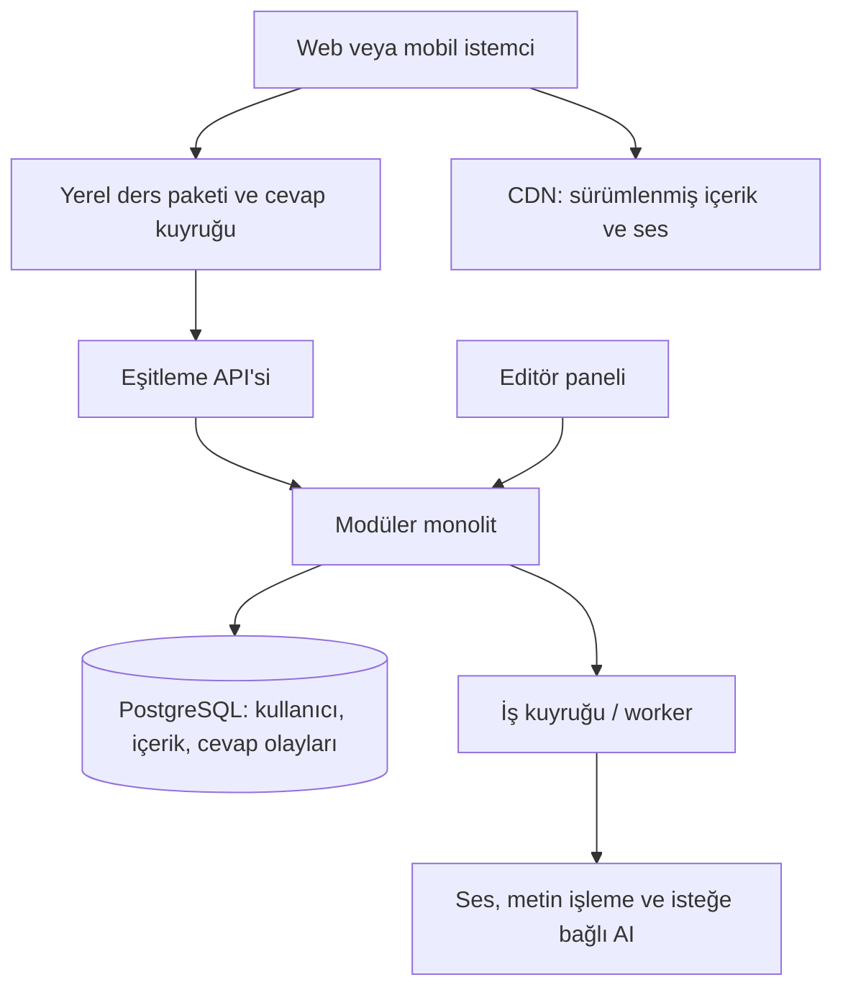

# Japonca öğrenme uygulamaları: ürün, yorumlar ve sistem tasarımı

Araştırma tarihi: **30 Ekim 2026**. Amaç: yeni bir Japonca çalışma ürünü için rakipleri, farklılaşma alanlarını ve teknik kararları değerlendirmek.

## 1. Karar özeti

Ürün fikri için önerdiğim başlangıç: **kısa okuma/dinleme içeriklerini, bağlamlı açıklamayı ve kişisel tekrar planını tek günlük döngüde birleştirmek**. Türkçe açıklamalar hedef kitle için bir hipotezdir; ödeme isteği veya pazar büyüklüğü bu araştırmayla kanıtlanmış değildir.

En doğrudan bütünleşik ürün referansları Renshuu ve MaruMori; gramer için Bunpro; kanji için WaniKani ve Kanji Study; içerikte okuma için Satori Reader; tekrar altyapısı için Anki; kişinin seçtiği medyaya hazırlık için jpdb'dir. Duolingo günlük alışkanlık, Busuu/HelloTalk insan geri bildirimi açısından incelenmeli.

Bu araştırmada uygulamalar aynı cihaz ve kullanıcı grubunda çalıştırılmadı. Öğrenme verimliliği, açılış hızı, batarya, çökme oranı veya sunucu gecikmesi için karşılaştırmalı ölçüm yapılmadı. Aşağıdaki üstünlük yorumları özelliklere dayalı ürün değerlendirmeleridir. Kamuya açık mühendislik sonuçları ayrıca etiketlenmiştir.

## 2. Pazar haritası

| Ürün | Doğrulanan odak ve özellikler | Ürün açısından öne çıkışı: benim çıkarımım | Tasarımda dikkat edilecek sınır |
| --- | --- | --- | --- |
| [Duolingo](https://blog.duolingo.com/learning-to-read-japanese-characters/) | Kısa dersler, Japonca yazı sistemlerini tanıma; oyunlaştırılmış öğrenme akışı | Çalışmaya başlama ve günlük geri dönüş tasarımı için referans | Oturum tamamlama ile gerçek üretim becerisi ayrı ölçülmeli |
| [Renshuu](https://www.renshuu.org/) | Kelime, kanji, gramer, sözlükler, farklı soru biçimleri; bilgiye göre görünüm ve kişisel yollar | Japonca odaklı geniş çalışma araçlarının birleşimi | Başlangıç kullanıcısında seçenek ve takvim karmaşıklığı test edilmeli |
| [LingoDeer](https://www.lingodeer.com/) | Gramer merkezli müfredat, açıklamalar, ana dili konuşanların sesleri, hikâyeler | Yönlendirmeli temel öğrenme | Müfredat ile serbest çalışmanın geçişi ayrıca tasarlanmalı |
| [MaruMori](https://marumori.io/) | Bölümlü öğrenme yolu; gramer, okuma, kelime/kanji ve SRS | Oyun dünyası ile bütünleşik öğrenme akışı | Pazarlanan seviye haritası ile gerçekten yayımlanan kapsamı ayır; web/mobil özellik eşitliği varsayma |
| [Bunpro](https://bunpro.jp/pricing) | Gramer açıklamaları, örnekler, ses, SRS, kelime desteği, kitap referansları ve okuma | Grameri açıklama ve aktif hatırlatma | Gramer başarısı doğrudan konuşma ustalığı sayılmamalı |
| [Bunpo](https://bunpo.app/) | Yapılandırılmış dersler, kana, kelime, kanji, gramer; konuşma tanıma ve AI konuşma özellikleri | Mobil ders ile pratik üretimi birleştirme | Ses ve yanıt doğruluğu, çalışma biçimi ve ücret sınırları incelenmeli; Bunpro'dan farklı üründür |
| [WaniKani](https://knowledge.wanikani.com/getting-started/how-wanikani-works/) | Radikal → kanji → kelime sırası, mnemonikler, anlam/okuma hatırlatma, SRS | Sınırları belirli kanji öğrenme sistemi | Genel Japonca müfredatının tamamı değildir; öğrenme sırası kullanıcının medya hedefiyle her zaman aynı olmayabilir |
| [Anki / AnkiDroid](https://apps.ankiweb.net/) | Kullanıcının kartları, medya, eşitleme, eklentiler ve özelleştirme | Kişisel tekrar sistemi ve veri taşınabilirliği | Başlangıç ayarları ve içerik hazırlama yükü kullanıcıya geçebilir |
| [Satori Reader](https://www.satorireader.com/features) | Bağlamda sözlük anlamı, cümle notları, ses, kanji/furigana görünümü ve bağlamlı kartlar | Orta düzeyde açıklamalı okuma/dinleme | Tam başlangıç için hazırlık eşiği ve editoryal içerik üretim maliyeti var |
| [jpdb](https://jpdb.io/) | Metinden kelime çıkarma, medya desteleri, desteler arasında bilgi takibi, bilinen kelimelere göre içerik keşfi | Öğrencinin tüketmek istediği içeriğe hazırlanma | Kelime kapsamı, eserin bütününü anlamanın garantisi değildir |
| [Kanji Study](https://play.google.com/store/apps/details?id=com.mindtwisted.kanjistudy&hl=en) | Yazım alıştırmaları, vuruş algılama, arama, örnekler, SRS; çevrimdışı sözlük | El yazısı ve kanji inceleme | Yükseltme/eklentilerin kapsamı ile beceri başına başarı durumu açık olmalı |
| [Busuu](https://www.busuu.com/en/app/learn-japanese-app) | Japonca dersleri, yazı sistemleri, manga kursları ve Japonca konuşanlardan geri bildirim | Müfredatla insan düzeltmesini birleştirme | Genel planlardaki AI özellikleri her dil/cihaz için aynı olmayabilir; [plan dipnotları](https://help.busuu.com/hc/en-gb/articles/16269241908497-What-is-Premium) kontrol edilmeli |
| [HeyJapan](https://play.google.com/store/apps/details?id=com.eup.heyjapan&hl=en) | Kana, tematik kelime, yazma, gramer, anime dublajı ve ilgi alanı temelli içerikler | Japonya/anime ilgisinden başlayan kullanıcı yolculuğu | İçerik doğruluğu, ses ve erişilebilirlik sürüm testleri önemli |
| [HelloTalk](https://www.hellotalk.com/en/features) | Metin, ses, video, düzeltmeler ve ses odalarıyla dil değişimi | Gerçek kişilerle iletişim ve kültürel bağlam | Ders uygulamasından farklı ağ ve topluluk ürünü; eşleşme, moderasyon ve etkileşim kalitesi gerekir |

MaruMori ana sayfası doğrudan açılırken erişim engeli verdi; resmi alan adının arama dizini ve [resmi değişiklik notları](https://marumori.io/changelog?entry=778534839) kullanıldı. Uçtan uca kullanım doğrulaması yapılmadı.

## 3. Hangi hedefte hangi referans önde?

Bu bölüm evrensel sıralama veya bilimsel başarı puanı değildir; ürün özelliklerine göre değerlendirmedir.

- **Günlük alışkanlık:** Duolingo. Dersin ilk dakikası, hedefler, ilerleme ve tekrar geliş mekanikleri incelenmeli.
- **Japonca odaklı geniş araç seti:** Renshuu. Kullanıcının zaten bildiğini ve ne çalışmak istediğini dikkate alan yapı değerli.
- **Yönlendirmeli gramer temeli:** LingoDeer; kapsamlı bütünleşik yol için MaruMori.
- **Grameri yazarak geri çağırma:** Bunpro. Soru ipuçları ve geçerli alternatifler, cevabın neden kabul edildiğiyle birlikte incelenmeli.
- **Kanji anlamı/okunuşu için yapılandırılmış yol:** WaniKani. **Vuruş ve yazma** için Kanji Study farklı bir referans.
- **Kullanıcının kontrol ettiği tekrar:** Anki. İçerik üretimi ve kart ayarları bu esnekliğin maliyeti.
- **Bağlam içinde okuma ve açıklama:** Satori Reader. Kullanıcının kendi medya hedefi ve metin çözümleme için jpdb.
- **İnsan geri bildirimi:** Busuu ve HelloTalk; ilki müfredatla, ikincisi dil değişimiyle yaklaşır.

Tek bir ürünü bütün alanlarda kazanan ilan etmek, farklı kullanıcı hedeflerini aynı puanda eritirdi.

## 4. Kullanıcı yorumu örneklemi ve sınırları

**9 ürün, 27 yorum kartı** incelendi: her üründen web görünümünde gösterilen 3 kart. Bunların **15'i 2026**, **12'si daha eski** tarihlidir. Örneklem Google Play'in İngilizce görünümlerindendir; ülke, cihaz ve sıralama sonuçları etkiler. MaruMori, WaniKani, jpdb, Busuu ve HelloTalk için bu örnekleme dahil edilmiş yorum seti yoktur. Anki yorumları masaüstü Anki'ye değil AnkiDroid'e aittir.

Bu bir duygu dağılımı veya memnuniyet yüzdesi araştırması değildir. Olumsuz yorumların sık görünmesi genel kullanıcıların çoğunun memnun olmadığı anlamına gelmez. Sürüm numarası görünmediğinde sürüm bilinmiyor. İddia edilen hatalar yeniden üretilmedi. Eski yorumlardan güncel özellik yokluğu çıkarılmadı. Duolingo'nun Korece/İspanyolca yorumları yalnızca genel ödeme/oturum tasarımına ilişkin sinyal olarak kodlandı.

Anonimleştirilmiş özetler, tarih, kaynak, geliştirici yanıtı bağlamı ve türetilen hipotezler: **[yorum-kanitlari.json](yorum-kanitlari.json)**.

### İzlenebilir bulgular

| Sinyal | Yorum kanıtı ve bağlam | Projeye dönüştürülecek gereksinim | Durum |
| --- | --- | --- | --- |
| Japonca ses hatasına güven kaybı | Bunpo R06, 03.08.2026; HeyJapan R14, 04.07.2026 | Bağlamlı ses test seti, dinleme editörü onayı, ses sürümleme ve geri dönüş | İki üründe kullanıcı bildirimi; güncel hata doğrulanmadı |
| Öğrenilmiş becerilerin tek puanda karışması | Kanji Study R19, 12.08.2026 | Anlam, okuma, yazma, dinleme ve bağlam becerileri ayrı takip edilmeli | Tekil ama doğrudan ürün isteği |
| Ayar gücü ile kullanım kolaylığı çatışıyor | Renshuu R03, 28.08.2026; AnkiDroid R25, 05.12.2024 | Basit günlük akış; gelişmiş ayarlar ayrı; anlaşılır tekrar takvimi | Farklı tarihlerde iki üründe görülen tema |
| Bilineni geçme ve hedefli tekrar | Bunpo R04, 28.04.2026; R05, 19.03.2025 | Seviye testi, kontrollü atlama, ünite/yanlış türü bazında tekrar | İstekler; güncel eksiklik kapsamı ayrıca doğrulanmalı |
| Büyük yazıda temel etkileşim bozuluyor | HeyJapan R13, 04.09.2026 | Büyük yazı ve ekran okuyucu ile çekirdek akış testleri | Kullanıcı bildirimi; geliştirici yanıtı var |
| Gün sınırı güven ilişkisini etkiliyor | Bunpro R24, 08.11.2025 | Saat dilimini görünür kıl, gün sınırını açık anlat ve farklı bölgelerde test et | Geliştirici ayarla düzeltilebildiğini söylüyor; kesin uygulama hatası sayılmadı |
| Müfredat sonrası yön kaybı | LingoDeer R12, 06.09.2026 | Seviye sonrası köprü içerik ve bir sonraki adım önerisi | Tekil deneyim; güncel müfredat sınırı yeniden doğrulanmadı |
| Fiyat kapsamı anlaşılmıyor | Bunpo R04; Kanji Study R21, 22.07.2026 | Satın alma öncesi hangi içeriğin açıldığı ve ek ücretler açık olmalı | Kanji Study kullanıcısının takip notu ve destek yanıtı yorumu yumuşatıyor |
| Rekabet herkesi motive etmiyor | Duolingo R07, 16.09.2026; Renshuu R02 oyunları övüyor | Rekabet/ligler isteğe bağlı; başarı ekranında öğrenme göstergeleri | Kullanıcı segmentleri farklı olabilir |
| Bağlamlı açıklamalar yüksek değer taşıyor | Satori R17/R18, 2020/2024; LingoDeer R12, 2026; Bunpro R22, 2026 | Kelimenin bu cümledeki anlamı ve gramer gerekçesi tek dokunuşta görünmeli | Tarihsel ve güncel olumlu deneyimler; kontrollü öğrenme ölçümü değil |
| Cihazlar arasında devam etme talebi | Kanji Study R20, 15.08.2026 | Yerel çalışma, hesap eşitlemesi ve dışa aktarma birlikte tasarlanmalı | Kullanıcı isteği; mevcut yedekleme özelliği yok sayılmadı |

Kaynak sayfaları: [Renshuu](https://play.google.com/store/apps/details?id=com.renshuu.renshuu_org&hl=en-US), [Bunpo](https://play.google.com/store/apps/details?id=com.bunpoapp&hl=en), [Duolingo](https://play.google.com/store/apps/details?id=com.duolingo&hl=en), [LingoDeer](https://play.google.com/store/apps/details?id=com.lingodeer&hl=en), [HeyJapan](https://play.google.com/store/apps/details?id=com.eup.heyjapan&hl=en), [Satori Reader](https://play.google.com/store/apps/details?id=com.braksoftware.SatoriReader&hl=en), [Kanji Study](https://play.google.com/store/apps/details?id=com.mindtwisted.kanjistudy&hl=en), [Bunpro](https://play.google.com/store/apps/details?id=bunpro.jp.bunpro_srs&hl=en), [AnkiDroid](https://play.google.com/store/apps/details?id=com.ichi2.anki&hl=en).

## 5. Kamuya açık sistem tasarımları

### Anki: incelenebilir bir teknik referans

[Geliştirici mimari belgesi](https://dev-docs.ankiweb.net/en/latest/architecture.html) Rust arka uç kütüphanesi, Python köprüsü, Qt/PyQt ile TypeScript/HTML/CSS arayüzü ve Protobuf kullanımını açıklıyor. [Koleksiyon belgeleri](https://docs.ankiweb.net/manual/files) yerel koleksiyon/medya dosyalarını ve SQLite üzerinden koleksiyon bakımını gösteriyor. Bu, masaüstü Anki'nin açıklanan mimarisidir; AnkiDroid'in bütün teknik yığınıyla aynı sayılmaz.

Yeni ürün için çıkarımım: tekrar oturumu ağ bağlantısı beklemeden yerelde çalışabilmeli; içerik/medya ve ilerleme eşitlemesi ayrı düşünülmeli. Bu çıkarım, Anki'nin her iç mekanizmasını birebir kopyalama önerisi değildir.

### Anki/FSRS: tekrar zamanlaması ile iş yükü dengesi

[Anki'nin FSRS belgesi](https://docs.ankiweb.net/manual/deck-options) hedeflenen hatırlama oranının tekrar yükünü etkilediğini ve geçmiş yanıtlarla kişiselleştirmeyi açıklıyor. [FSRS-rs](https://github.com/open-spaced-repetition/fsrs-rs) zamanlayıcı ve optimizasyon için incelenebilir bir uygulamadır. Lisansı ve kullanılacak sürümü uygulama kararında ayrıca kaydet.

Yeni ürün için çıkarımım: kullanıcının günlük zamanı ile tekrar hedefini birlikte yönetmek, yeni kelime eklemeyi tekrar borcuna göre ayarlamak ve yanlış yanıtı dürüstçe kaydetmek gerekir. Algoritmik hatırlama tahmini, ölçülmüş dil yeterliliği değildir.

### WaniKani: açık API sözleşmesi

[Resmî API](https://docs.api.wanikani.com/20170710/) subjects, assignments, reviews ve review statistics gibi kaynakları ayırıyor. Koşullu istekler, değişen kayıtları alma ve önbellekleme önerileri var; açıklanan API sınırı dakikada 60 istektir. Bu dış API sözleşmesi tam backend/veritabanı topolojisini açıklamaz ve uygulamanın eşzamanlı kullanıcı kapasitesi anlamına gelmez.

Yeni ürün için çıkarımım: öğrenilecek içerik, kullanıcıya atama, cevap olayı ve özet öğrenme durumu ayrı modellenmeli. Sözlük içeriği ile sık değişen kullanıcı olaylarını aynı önbellek politikasıyla yönetmemek gerekir.

### Duolingo: açıklanan bileşenler ve tarihsel performans

Eski [Session Generator yeniden tasarım yazısı](https://blog.duolingo.com/rewriting-duolingos-engine-in-scala/) ortak bağımlılıkların azaltılmasını, ders verisinin ön işlenip S3 dosyalarına yazılmasını ve kullanıcı verisinin isteğe eklenmesini anlatıyor. Yazıda bileşen gecikmesinin **750 ms'den 14 ms'ye** düşürüldüğü bildiriliyor. Bu güncel uygulama p95 değeri değildir; sonuç yalnızca programlama dili değişimine bağlanamaz.

[2024 Android performans çalışması](https://blog.duolingo.com/unique-engineering-problems/) izlerle açılış darboğazlarını bulmayı, kritik olmayan işleri ertelemeyi ve yalnızca gereken kurs metadatasını getirmeyi anlatıyor; şirket açılış süresinde **%40 iyileşme** bildiriyor. Bu şirketin tarihli iç karşılaştırmasıdır; diğer uygulamalardan %40 hızlı olduğu anlamına gelmez.

[Birdbrain açıklaması](https://blog.duolingo.com/learning-how-to-help-you-learn-introducing-birdbrain/) öğrenci bilgisi ve soru zorluğu modelini anlatıyor. İçerik üretimi, ders seçimi ve kişiselleştirme farklı işlevlerdir; bütün deneyimi tek sohbet modeline bırakmak zorunlu değildir.

### jpdb: öğrenme algoritmasının açıklaması var

[FAQ](https://jpdb.io/faq), tekrar geçmişinden unutma eğrisi modelleme ve medya zorluğunu öğrenilmiş özelliklerle tahmin etmeyi açıklıyor. Tam servis/veritabanı mimarisi bu araştırmada doğrulanmadı. Yeni ürün açısından, öğrencinin bildiği kelimeleri içerik seçimiyle ilişkilendirmek araştırmaya değer.

Renshuu, MaruMori, Bunpro, Bunpo, Satori Reader ve diğer kapalı ürünler için bu araştırmada ayrıntılı üretim topolojisi doğrulanmadı. Görünen arayüzden PostgreSQL, Redis veya mikroservis kullandıkları sonucu çıkarılmadı.

## 6. Performansı nasıl kıyaslamalıyız?

| Alan | Gerçek ölçüm | Yanlış vekil ölçü |
| --- | --- | --- |
| Kelime/kanji hatırlama | Eşlenmiş içerikte 7 ve 30 gün sonra, ipucusuz, ayrı okuma/anlam testleri | Kart sayısı veya XP |
| Gramer aktarımı | Eğitimde görülmemiş cümlede doğru anlama ve üretim | Aynı cümlede doğru seçeneği tanıma |
| Okuma | Eşdeğer metinlerde anlama soruları, okuma süresi, sözlük bakma ihtiyacı | Sadece metni bitirme |
| Dinleme/konuşma | Ayrı dinleme testi ve eğitmenlerin kör değerlendirdiği görevler | ASR güven değerini doğrudan telaffuz puanı sayma |
| Zaman verimliliği | Harcanan aktif dakika başına gecikmeli öğrenme kazanımı | Uygulamada geçirilen toplam süre |
| Ürün bağlılığı | Aktivasyon, D7/D30 geri dönüş, oturumu yarıda bırakma | Seri sayısını öğrenme başarısı sayma |
| Teknik kalite | Aynı cihaz/ağda soğuk açılış, p95 etkileşim, çökme, offline başarı, eşitleme kaybı/tekrarı | Farklı koşullardaki mağaza yıldızları |

Yapılacak araştırma önerisi: önce 8–12 hedef kullanıcıyla ilk kullanım sorunlarını gözle. Bu sayı öğrenme üstünlüğünü kanıtlamaz. Daha sonra karşılaştırmalı öğrenme deneyi için seviye, ana dil, önceki bilgi, süre, içerik ve cihazları dengele; örneklem büyüklüğünü beklenen etkiye göre planla. Tekrar testinde aynı kelimeleri iki farklı uygulamada öğretip bir uygulamanın etkisini diğerine taşımamaya dikkat et.

Türkçe bilenlerin öğrenme hataları veya ödeme isteği için bu örneklem yeterli değildir. Bunlar ayrı görüşme ve pilot kohortlarıyla araştırılmalı.

## 7. Yeni ürün için önerilen çekirdek deneyim

Hipotez: Türkçe ve/veya İngilizce destek isteyen, kana temelini edinmiş ve kısa Japonca metinlere geçmek isteyen kullanıcı.

Günlük döngü: **kısa içerik → kelime/gramer açıklaması → küçük üretim görevi → kişisel tekrar → daha sonra aynı bilgiyi yeni bağlamda kullanma**.

İlk kapsam için önerim:

- Hedef/seviye seçimi ve bir örnek içeriği hemen deneme.
- Editör onaylı küçük bir içerik seti; ses-cümle eşlemesi ve kademeli furigana.
- Bilinen kelimeler ve kanjiler; okuma, anlam, dinleme, yazma için ayrı beceri durumu.
- Yanlışın nedenini açıklama, geçerli cevap varyantları ve madde bazlı hata bildirimi.
- SRS kuyruğu, günlük zaman bütçesi, tekrar yükünü görünür kılan takvim.
- Çevrimdışı ders paketi, yerel cevap kaydı, güvenilir eşitleme ve dışa aktarma.
- Haftalık küçük aktarım testleri; oyunlaştırma tercihleri isteğe bağlı.

Öncelik önerileri yorum sıklığından hesaplanan puanlar değildir. Önce güveni bozan içerik/cevap/ses hataları, veri kaybı riski ve erişilebilirlik; ardından günlük akış, kişiselleştirme ve ücret kapsamı ele alınmalı. Rekabetçi ligler, herkese açık sohbet ve sınırsız AI görüşmesi, değer önerisi doğrulandıktan sonra ayrı maliyet/kalite deneyi olabilir.

Fiyatlama modeli önerisi: ücretsiz katmanda gerçek bir öğrenme döngüsü; premiumda geniş editoryal içerik, planlama ve eşitleme değeri; değişken maliyetli AI konuşmasında açık kullanım sınırı. Gerçek fiyatı bu araştırmadan türetmiyoruz.

## 8. Önerilen başlangıç mimarisi

Bu, rakiplerden birinin doğrulanmış mimarisi değil; bu ürün için benim tasarım önerimdir.

Başlangıçta tek backend içinde kimlik/abonelik, içerik, tekrar planlama, ilerleme ve eşitleme modülleri yeterli bir adaydır. Veri ilişkileri için PostgreSQL; yerel mobil çalışma için SQLite, web prototipinde IndexedDB değerlendirilebilir. Medya dosyaları nesne depolama/CDN üzerinden sunulur. İlk sürümde Redis/Kafka eklemek yerine gerçek darboğaz ölçülür; uzun süren işler arka plan kuyruğuna ayrılır. İstemci türü, hedef cihaz ve çevrimdışı ses deneyimiyle seçilmeli.

### Japoncaya özgü veri modeli

- `lexeme`: sözcük; okunuş ve anlam ilişkileri. Sadece görünen karakter dizisini anahtar sayma.
- `kanji`, `reading`, `sense`: farklı yazım/okuma/anlamları temsil et.
- `sentence`, `grammar_point`, `audio_segment`: bağlam, açıklama ve ses bağlantıları.
- `content_revision`: içerik ve cevap anahtarının sürümü.
- `review_event`: kullanıcı cevabı, beceri türü, süre, istemci kimliği, içerik ve algoritma sürümü.
- `skill_state`: kullanıcı × öğe × beceri bazında öğrenme durumu.
- `issue_report`: sorunlu madde, gerekçe, inceleme ve düzeltme durumu.

[JMdict](https://www.edrdg.org/jmdict/j_jmdict.html) gibi kaynaklar veri modelini ve sözlük katmanını beslemek için incelenebilir; kaynak ve lisans koşulları içerik kaydında tutulmalı. Rakiplerin özel örneklerini, seslerini veya açıklamalarını kendi veri setimizmiş gibi kullanmayız.

### Eşitleme ve doğruluk

Her cevaba benzersiz olay kimliği verilir. İstemci olayı yerelde kalıcı kaydeder; sunucu aynı kimliği ikinci kez aldığında tekrar uygulamaz. Sunucu onayı gelene kadar olay kuyrukta kalır. Öğrenme durumu gerektiğinde olay geçmişinden yeniden hesaplanabilir. Bu öneri bütün sistemi olay kaynaklı yapmak veya Kafka kullanmak anlamına gelmez; bir PostgreSQL olay tablosu ve hesaplanmış durumla başlanabilir.

İki cihazın çevrimdışı cevapları, aynı cevabın tekrar gönderilmesi, saat sapması, gün sınırı ve içerik sürümü değişiklikleri test setine alınır. Seri, öğrenme durumundan ayrı bir ürün metriği olmalı.

### AI'nin rolü

AI; onaylı kaynaklara dayanarak ek açıklama, kontrollü diyalog ve hata kümelerini özetleme için denenebilir. Temel cevap anahtarı ve kabul edilen varyantlar sürümlenebilir olmalı. Ses/telaffuz değerlendirmesini Japonca eğitmenlerinin bağımsız değerlendirmeleriyle karşılaştırmadan kesin bir yeterlilik puanı sunmayız. Kurala dayalı alıştırmanın puanlama yolunu bir model çağrısının gecikmesine bağlamamak, performans açısından değerlendirilecek tasarım kararıdır.

## 9. İlk doğrulama listesi

1. Hedef kullanıcı kim: kana başlangıcı, N5–N4 temeli, N4–N3 okuma geçişi veya belirli medya?
2. Kullanıcı bugün hangi iki/üç aracı birlikte kullanıyor; aradaki hangi işi elle yapıyor?
3. Aynı kısa içeriği mevcut araçlarla ve prototiple tamamladığında açıklık, süre ve gecikmeli hatırlama nasıl değişiyor?
4. Ses, alternatif doğru cevap ve furigana davranışı için editör onaylı test seti var mı?
5. Büyük yazı, Japonca klavye ve tamamen çevrimdışı oturum tamamlanabiliyor mu?
6. Eşitleme tekrarları, iki cihaz ve saat dilimi değişiminde cevaplar korunuyor mu?
7. Kullanıcı premiumun ne açtığını satın almadan önce doğru anlatabiliyor mu?

Bu çıktılar bir pazar araştırması ve tasarım hipotezidir. Mevcut Systema uygulamasında veya GitHub deposunda bu araştırma nedeniyle değişiklik yapılmadı.
